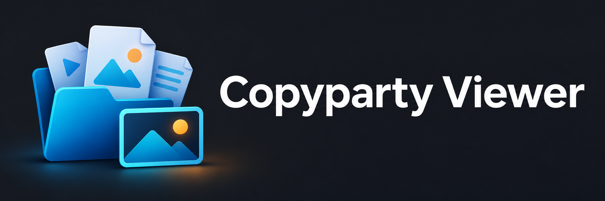
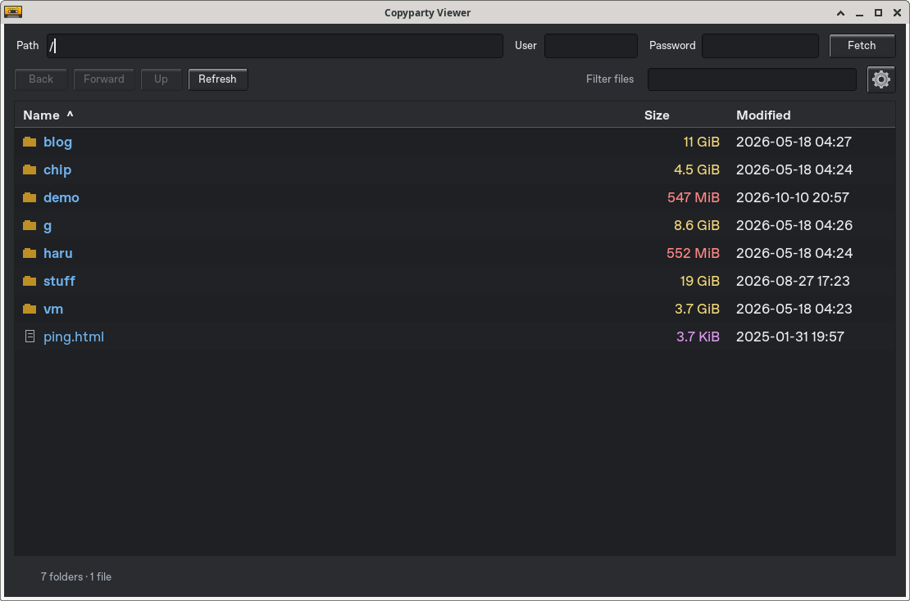
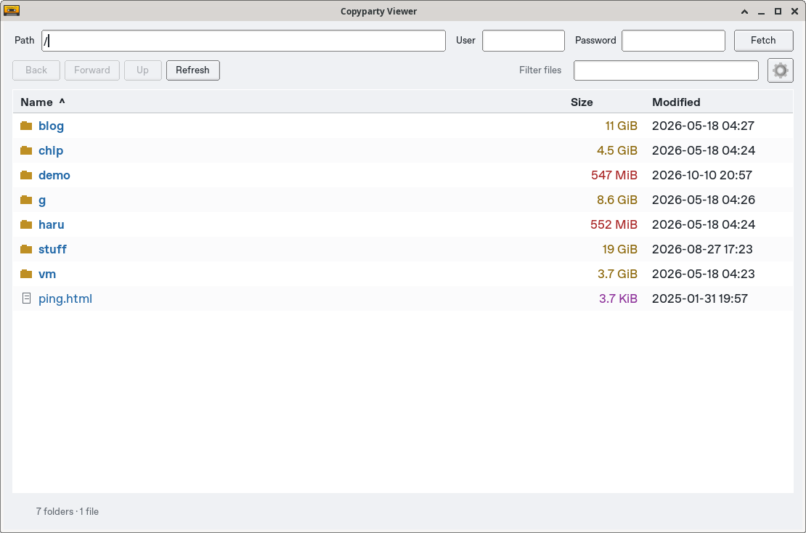
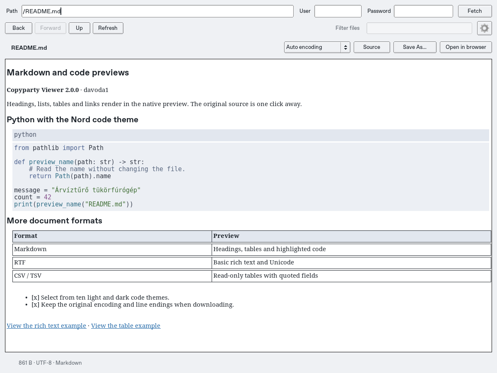

# Copyparty Viewer



A small, read-only desktop client for [Copyparty](https://github.com/9001/copyparty), written in C++17 with FLTK and libcurl. Browse directories, preview documents, code and images, and download individual files on Windows or Linux.

**[Download v2.0.0](https://github.com/Davoda1/CopypartyViewer/releases/tag/v2.0.0)** · [Build from source](BUILDING.md) · [Contributing](CONTRIBUTING.md) · [Security](SECURITY.md) · [MIT license](LICENSE)

## Features

- **Two clickable directory views.** Modern offers a sortable table; Retro presents Copyparty's colored terminal-style listing with large monospaced text. Both retain the editable path and navigation controls.
- **Responsive fetching.** Network requests and preview decoding run on workers, with an animated bottom indicator, transfer progress and a nearby Cancel button.
- **Native document previews.** Render Markdown, basic RTF and CSV/TSV tables, with a Source / Rendered switch.
- **Selectable code highlighting.** Ten code themes, each with light and dark colors, apply to recognized source files and Markdown code blocks.
- **Text encodings and line endings.** Read CP1250, CP1252, UTF-8, UTF-16 and UTF-32 text. CRLF, LF and CR are handled automatically, with an encoding selector for ambiguous files.
- **Image and ANSI-text previews.** Preview PNG, JPEG, WebP, SVG, BMP, ICO and GIF files; ordinary terminal text retains ANSI colors and bold.
- **Consistent size sorting.** Known sizes sort numerically, unknown sizes follow in either direction, and folders stay first.
- **Familiar navigation.** Back, Forward, Up, Refresh, directory filtering, keyboard shortcuts and restored filter/scroll positions.
- **Separate Settings window.** Save the server, account, view preferences, last path and window geometry in one per-user JSON file.
- **Compact native packages.** One real application executable, with application libraries linked statically where practical. No launcher scripts, companion application DLLs or separate curl program.

The default server is the official public demo at **https://a.ocv.me/pub/**. Release executables contain **no embedded username or password**. The viewer has no server upload, rename, deletion or editing commands.

## Screenshots

Native Linux application captures. The directory views browse the official demo with an empty login; the document preview uses a controlled example file.

### Dark appearance



### Light appearance



### Markdown and highlighted code

The native document preview with the Nord code theme, rendered Markdown and a table.



## Downloads

| Platform | Release asset | Start |
| --- | --- | --- |
| Windows x64 | [Copyparty-Viewer-2.0.0-Windows-x64.zip](https://github.com/Davoda1/CopypartyViewer/releases/download/v2.0.0/Copyparty-Viewer-2.0.0-Windows-x64.zip) | Extract and run `CopypartyViewer.exe`. |
| Debian-family Linux amd64 | [copyparty-viewer_2.0.0_amd64.deb](https://github.com/Davoda1/CopypartyViewer/releases/download/v2.0.0/copyparty-viewer_2.0.0_amd64.deb) | Install with the package manager. |
| Linux amd64 | [Copyparty-Viewer-2.0.0-Linux-amd64.tar.gz](https://github.com/Davoda1/CopypartyViewer/releases/download/v2.0.0/Copyparty-Viewer-2.0.0-Linux-amd64.tar.gz) | Run directly or install manually with `sudo`. |

The release has these three uploaded binary assets. GitHub supplies the **Source code (zip)** and **Source code (tar.gz)** downloads automatically on the [release page](https://github.com/Davoda1/CopypartyViewer/releases/tag/v2.0.0). They contain the repository at the release tag.

### Requirements

| Platform | Runtime requirements |
| --- | --- |
| Windows | 64-bit Windows 10 or 11 and normal Windows certificate trust. The executable is unsigned. |
| Linux | amd64, glibc 2.31 or newer, an X11-compatible display, the usual X11/Xft/fontconfig libraries and a system CA certificate bundle. XLibre or an XWayland session can provide the display. |

The application needs normal operating-system services for windows, fonts, networking and certificate validation. It does not require a compiler, Python, CMake or a separate curl installation to run.

### Verify a download

GitHub computes a SHA-256 digest for each uploaded release asset. The `assets` entries in the [v2.0.0 release metadata](https://api.github.com/repos/Davoda1/CopypartyViewer/releases/tags/v2.0.0) contain each asset's filename and `digest` in `sha256:...` form. Compare the matching digest with a locally calculated hash:

```powershell
Get-FileHash .\Copyparty-Viewer-2.0.0-Windows-x64.zip -Algorithm SHA256
```

```sh
sha256sum Copyparty-Viewer-2.0.0-Linux-amd64.tar.gz
```

The digest refers to the uploaded binary asset with that exact filename. GitHub's automatically generated source downloads are separate from the three binary assets.

## Install and run

### Windows

Extract the ZIP and run **CopypartyViewer.exe**. No installer is needed. Configuration is stored in your roaming application-data directory, so moving the executable does not reset your settings.

### Debian-family Linux

From the directory containing the package:

```sh
sudo apt install ./copyparty-viewer_2.0.0_amd64.deb
copyparty-viewer
```

The package also adds a **Copyparty Viewer** desktop applications entry and installs the actual binary at `/usr/bin/copyparty-viewer`. To remove it:

```sh
sudo apt remove copyparty-viewer
```

Your per-user configuration is retained.

### Manual Linux installation

The TAR.GZ contains the executable at its root. Extract it into a dedicated directory:

```sh
mkdir -p Copyparty-Viewer-2.0.0
tar -xzf Copyparty-Viewer-2.0.0-Linux-amd64.tar.gz -C Copyparty-Viewer-2.0.0
cd Copyparty-Viewer-2.0.0
./copyparty-viewer
```

For a system-wide installation, run these commands from that extracted directory:

```sh
sudo install -D -m 755 copyparty-viewer /usr/local/bin/copyparty-viewer
sudo install -D -m 644 share/applications/copyparty-viewer.desktop /usr/local/share/applications/copyparty-viewer.desktop
sudo install -D -m 644 share/pixmaps/copyparty-viewer.png /usr/local/share/pixmaps/copyparty-viewer.png
sudo install -d /usr/local/share/doc/copyparty-viewer
sudo cp README.md BUILDING.md CHANGELOG.md CONTRIBUTING.md SECURITY.md LICENSE THIRD_PARTY_NOTICES.md /usr/local/share/doc/copyparty-viewer/
sudo cp -r third-party-licenses docs /usr/local/share/doc/copyparty-viewer/
```

The desktop entry runs the same binary. To remove a manual installation, remove the exact installed executable, desktop entry, icon and documentation directory above. Per-user configuration is retained until you remove it yourself. Use either the Debian package or a manual installation on a given system to keep ownership of installed files clear.

## Browsing

On the first launch, the window appears and the configured root is fetched automatically. With the demo server, the application's `/` path means `https://a.ocv.me/pub/`. Later launches restore the last path, saved account and window state, then fetch automatically. Existing saved settings take precedence over build defaults; replacing the executable does not reset your chosen server.

- **Path** accepts a path from the configured root, a path relative to the current directory, or a full URL inside the configured base directory. Use Settings to change servers.
- **User** and **Password** in the main window apply to the current session. Press Enter or Fetch to use them. Password entry is masked. Editing these fields does not replace the account saved in Settings.
- Click a **folder name** to enter it or a **file name** to preview it. Arrow keys select rows; Enter opens the selection. Modern column headings change sorting, with folders kept above files.
- **Back**, **Forward**, **Up** and **Refresh** navigate the current server. Returning to a directory restores its filter and scroll position.
- **Filter files** filters the current directory; it does not search the entire server.
- **Save As** downloads the selected file. A failed or cancelled download leaves an existing destination intact; replacement occurs only after a successful transfer.
- **Open in browser** opens a credential-free URL. The browser manages its own login.

The bottom indicator animates while a request or preview is being prepared. Transfer progress includes byte counts and a determinate bar when the size is known. **Cancel** is beside the indicator. Cancelled or superseded requests cannot replace a newer view.

### Modern and Retro

The animated **Modern / Retro** switch in Settings chooses the presentation. Modern is the default: a sortable table whose columns fit the available width, with 17-unit listing text. Retro uses 22-unit monospaced text and allows horizontal scrolling for long lines. FLTK logical font sizes follow platform DPI scaling.

Retro uses the server's genuine colored terminal listing when available, including account, permissions and server information. A local formatting fallback uses the parsed directory metadata. Switching to Retro refreshes its listing in the background while preserving the filter and scroll position. Both modes retain clickable names, navigation, the editable path and previews.

Retro timestamps use `YYYY-MM-DD HH:MM:SS` on the UTC time basis. Dotted focus outlines are omitted, while keyboard navigation, shortcuts, selection highlights and text cursors remain available.

**Directory sizes** is On by default and shows folder totals when the server supplies them. The viewer does not recursively crawl directories to calculate missing totals. With the switch Off, Modern shows a dash for folders and Retro leaves the folder size field blank. File sizes remain visible and color-coded. Both switches remain drafts until Settings is saved.

Size sorting keeps unknown values after known values in both directions. When directory sizes are hidden, folders sort by name instead of their hidden size. Equal sort values use consistent name/path comparisons.

### Keyboard shortcuts

| Shortcut | Action |
| --- | --- |
| Ctrl+L | Focus and select the path. |
| Ctrl+F | Focus the directory filter. |
| F5 or Ctrl+R | Refresh. |
| Alt+Left / Alt+Right | Back / Forward. |
| Alt+Up | Parent directory. |
| Enter | Fetch from an input or open the selected row. |
| Ctrl+S | Save the previewed file. |
| Escape | Cancel the active operation; in Settings, discard unapplied edits. |

## Previews

| Format | Support |
| --- | --- |
| PNG | Grayscale/color and transparency. |
| JPEG / JPG | Grayscale, RGB and CMYK. |
| WebP | Lossy, lossless and alpha; first frame of animated files. |
| SVG | Paths, geometric shapes and gradients through NanoSVG. Text, external images, scripts and `<use>` references are not rendered. |
| BMP | Common 1/4/8/16/24/32-bit encodings, bitfields and RLE4/RLE8. |
| ICO | PNG-compressed and bitmap icons, selecting the largest available image. |
| GIF | Palette transparency and interlacing; first-frame preview. |
| Markdown | Headings, emphasis, lists, quotations, tables, task markers, links, inline code and fenced code blocks. |
| RTF | Basic rich text with styles, font sizes, RGB text colors, paragraphs and alignment. |
| CSV / TSV | Read-only tables with quoted fields, escaped quotes, multiline cells and comma, semicolon or tab delimiters. |
| Code | Syntax colors for recognized source and configuration files. |
| Text | Read-only Unicode and Windows encodings, common source/configuration formats and HTML source; ANSI colors and bold. |

Images fit the preview pane while preserving proportions, with a checkerboard for transparency. Animated files can be downloaded or opened in a browser for full playback. The application does not execute HTML or SVG scripts.

Preview transfers are limited to 64 MiB, directory listings to 16 MiB, and text input/display to 8 MiB. Formatted Markdown, RTF and CSV previews have a 512 KiB limit; larger or unsupported documents open as source with a status message. Image decoding is bounded to 64 megapixels and 32,768 pixels per dimension. SVG source has a 4 MiB limit and its raster preview is limited to 4,096 pixels per dimension. Text truncation is indicated. Use Save As for files larger than the preview limits.

### Text encodings and line endings

The file toolbar offers **Auto encoding**, **UTF-8**, **UTF-16 LE**, **UTF-16 BE**, **UTF-32 LE**, **UTF-32 BE**, **CP1250** and **CP1252** for ordinary text, Markdown, CSV and code files. Auto checks Unicode byte-order marks, a supported charset declared by the server, and conservative alignment patterns for UTF-16/UTF-32 without a byte-order mark. It then accepts valid UTF-8 or falls back to Windows-1250. Choose CP1252 when an older Western European file needs that encoding.

Changing the selector decodes the already fetched file again; it does not download it again. The choice applies to the current open file and resets to Auto when you navigate. Windows CRLF, Unix LF and older CR line endings are normalized for viewing. **Save As always downloads the original bytes**, retaining the file's encoding and line endings. RTF formatting uses the character encoding recorded inside the RTF document, so its preview does not use this toolbar selector.

### Markdown and code themes

Open a Markdown file such as `README.md` to see its rendered document. The **Source** button shows its text; **Rendered** returns to the document view. Recognized extensions include `.md`, `.markdown`, `.mdown`, `.mkd`, `.mkdn`, `.mdtext` and `.mdtxt`; Markdown content types are recognized too. **Save As** always downloads the original file.

Open Settings and choose **Code theme**, then **Save**. The choices are **Default**, **VS Code**, **GitHub**, **Monokai**, **Nord**, **Dracula**, **Solarized**, **Codex**, **Xcode Classic** and **Ayu**. Each includes light and dark colors that follow the application's automatic system appearance. The selection applies to fenced Markdown code blocks and recognized code-file previews, and is remembered across launches. Cancel discards an unapplied selection.

Fenced code uses its language label, such as `cpp`, `python`, `javascript`, `bash` or `powershell`. Standalone files use their extension or a recognized filename. Highlighting covers C/C++, JavaScript/TypeScript, Python, shell scripts, PowerShell, JSON, YAML, HTML/XML, CSS, SQL, Rust, Go, Java, C#, PHP and INI-style configuration. Common aliases are accepted. Unrecognized or unlabeled fences remain readable plain code. Highlighting colors tokens for reading; it does not compile, execute or validate programs.

Document links to relative paths or files on the configured server open in the viewer. Heading links move within a rendered document. Explicit HTTP/HTTPS links outside that server base, and links containing a query, open in the default browser without attaching the viewer's credentials. The browser manages its own login. Unsupported schemes and malformed destinations cannot open through the preview.

The document preview uses the native FLTK display and a bundled Markdown parser. Raw HTML is displayed as text. Markdown images appear as labeled links using their alternative text; they are loaded only when opened as a separate file or in the browser. Task-list checkboxes are read-only markers. JavaScript, embedded web pages, diagrams and mathematical typesetting are outside this preview's scope. No webview, CDN or downloaded rendering script is required.

### Basic RTF documents

Files ending in `.rtf`, or served as `application/rtf`, `text/rtf` or `application/x-rtf`, open with basic rich-text formatting. The preview supports bold, italic, underline, bounded font sizes, RGB text colors, paragraphs, line breaks, tabs and left/center/right alignment. Unicode escapes and documents using Windows-1250, Windows-1252 or explicitly declared UTF-8 are supported. The **Source / Rendered** button switches between the RTF source text and its formatted preview.

RTF uses a white document surface and the document's text colors even when the application follows a dark system theme. Code-theme choices do not recolor RTF. Embedded pictures, objects, fonts and complex page layout are omitted. Field result text can be displayed, while field instructions are ignored and never executed. Unsupported encodings or malformed structures fall back to source. This is a basic document preview, with no claim of complete word-processor compatibility.

### CSV and TSV tables

CSV and TSV files open as tables. Quoted delimiters, doubled quotes, embedded line breaks, empty cells and trailing fields are preserved. Comma, semicolon and tab delimiters are detected from the data; an optional Excel `sep=` line can select one explicitly. Every actual row is treated as data, including the first. Short rows receive empty cells to fit the table. Formula-like values and URLs remain literal cell text.

Use **Source / Rendered** to switch between the delimited text and table view. To keep the native table responsive, preview is limited to **500 rows**, **64 columns**, **10,000 displayed cells**, **16 KiB per field**, **512 KiB of input** and **2 MiB of generated table markup**. Malformed quoting or a limit reached produces a source preview with a status message. You can still download the complete original file.

## Settings

The gear opens a separate, modeless **Copyparty Viewer — Settings** window while the main window remains usable. Opening Settings again raises the existing window. **Save** applies and remembers changes; **Cancel**, Escape and the window's close button discard unapplied edits.

Settings shows the saved account, not temporary credentials typed into the main window. **Only Settings Save writes account changes.** Saving display preferences preserves both the saved account and any active temporary login. A server change resets browsing to its root; an already-started download retains its original server and credential snapshot.

All persistent settings use one JSON file:

| Platform | Location |
| --- | --- |
| Windows | `%AppData%\CopypartyViewer\settings.json` |
| Linux | `~/.config/copyparty-viewer/settings.json` |
| Linux with an absolute `XDG_CONFIG_HOME` | `$XDG_CONFIG_HOME/copyparty-viewer/settings.json` |

The file records the server, last path, saved credentials, view, directory-size and code-theme preferences, main-window normal position/size and maximized state, and Settings-window geometry. Geometry is clamped to available screens. Light/dark appearance follows supported desktop settings automatically. Windows requests matching native title-bar colors where supported and preserves high-contrast colors; Linux decorations remain under the window manager's control.

**Saved credentials use portable reversible obfuscation.** No master password is required, but this is not strong encryption: someone who can read the JSON and application code can recover the saved login. Keep the file private. Writes use atomic replacement, and Linux files are restricted to their owner. To reset the app, close it and rename or remove the JSON file.

Custom builds can supply different server/account defaults. They are not automatically copied into the JSON. An explicit Settings Save records the chosen account, including an intentionally blank one. Official release defaults remain the demo URL and empty credentials.

## Build and validation

Clone the repository or download GitHub's source archive for the release, then follow [BUILDING.md](BUILDING.md). GNU Make is the entry point on Linux; Windows uses `mingw32-make` with matching `gcc`, `g++` and `windres` tools in `PATH`.

```sh
make help
make JOBS=4
make test
make package
```

Dependencies are pinned: source archives are included in `vendor/sources`, and the Markdown parser sources are in `vendor/md4c`. Headers, static libraries and intermediate products are built inside `build/`. The application uses FLTK **1.4.5**; the build guide lists the remaining exact dependency versions and platform requirements.

[Validation notes](docs/VALIDATION.md) describe local checks, package inspection and the hosted release gates. See [GitHub Actions](https://github.com/Davoda1/CopypartyViewer/actions) for the results of the exact commit: native Linux and Windows tests, package verification and C++ security analysis.

## License and attribution

**Copyright © 2026 davoda1.** Project-owned code and documentation are available under the [MIT License](LICENSE).

Third-party components and artwork retain their own licenses and attribution. See [THIRD_PARTY_NOTICES.md](THIRD_PARTY_NOTICES.md) and `packaging/third-party-licenses/` in the repository; binary packages include the notices in `third-party-licenses/`. Copyparty Viewer is an independent client project and does not claim to be the Copyparty server project.
